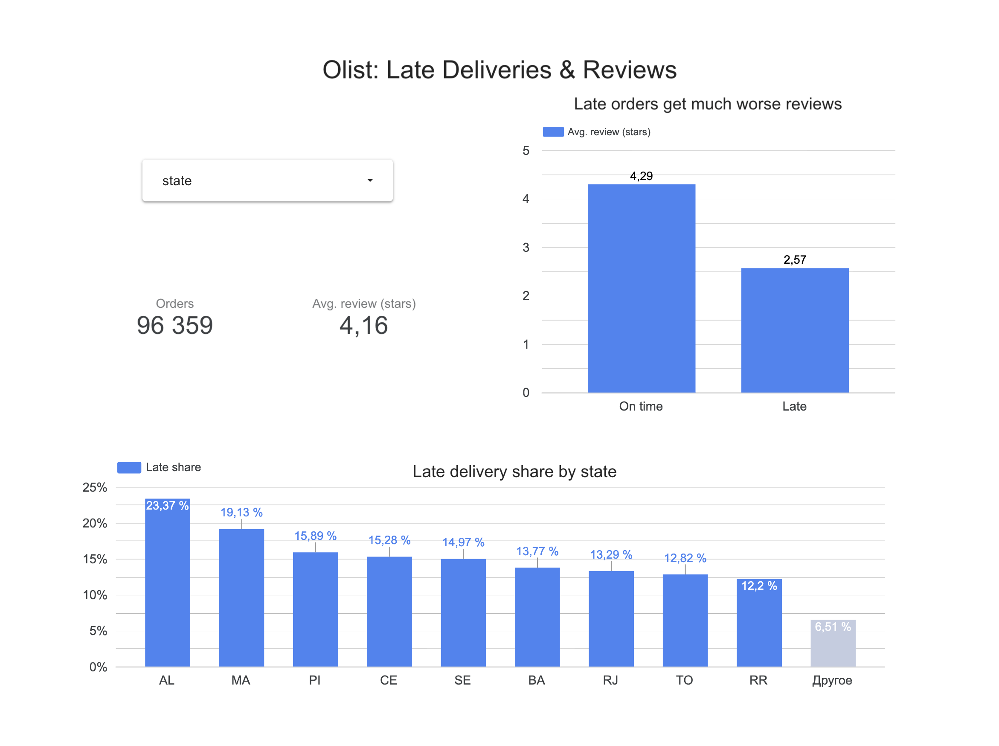
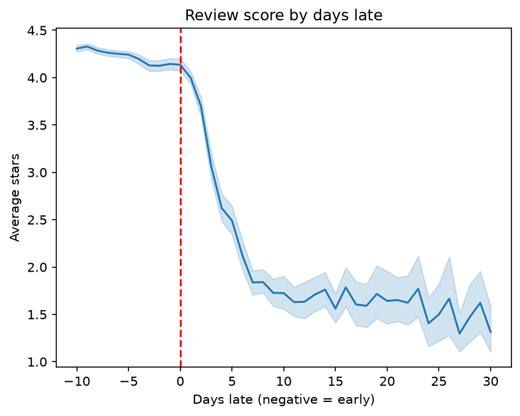

# Olist: How Late Deliveries Affect Customer Reviews

Analysis of ~96,000 orders from the Brazilian e-commerce marketplace Olist (Kaggle).

**Tools:** SQL (SQLite), Python (pandas, seaborn, SciPy), Looker Studio
**Dashboard:** https://datastudio.google.com/reporting/64577055-c0ae-45a3-8a11-62f550a23707

## Question
Do late deliveries lead to worse customer reviews, and where do they happen most?

## Key findings
1. About 8% of delivered orders arrived late (7,827 orders).
2. Late orders get 2.57 stars on average vs. 4.29 for on-time orders (Welch t-test, p < 0.001).
3. 54% of late orders receive a 1–2 star review, compared to 9.2% of on-time orders.
4. Ratings collapse within the first week of delay (from 4.1 to about 1.8 stars), while early delivery adds little.
5. Northeastern states are hit hardest: AL 23.4% late, MA 19.1%.

**Recommendation:** Realistic delivery estimates and better logistics in the Northeast would reduce bad reviews the most.

## Charts

## Project structure
- `sql/`: SQL queries (JOINs, CASE, CTE, window functions)
- `notebooks/`: Python analysis, charts and t-test

Data: Brazilian E-Commerce Public Dataset by Olist (Kaggle)
